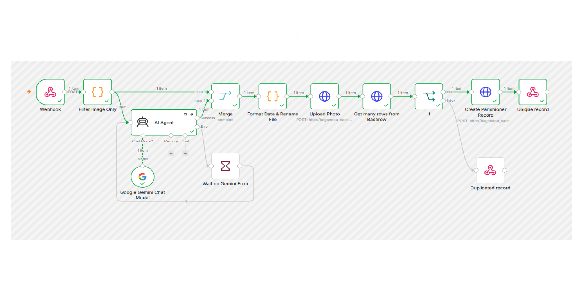

# Autonomous Edge Stack for CAR Mission (Bagandou)

<p align="center">
  
</p>

[PL] Polska wersja opisu znajduje się poniżej.

Production-ready Infrastructure as Code (IaC) template deployed on-site in Bagandou (Central African Republic) to digitize parish archives and operate autonomously in off-grid conditions.

## 🚀 Architecture Overview (As-Built)

Data persistence relies on local bind mounts (`./dane_*`) stored on a **Btrfs RAID1 mirror (NVMe + SSD)**. This setup protects against sudden power cuts without requiring a physical UPS and allows instant read-only snapshots.

### Core Components:
* **ODK Collect Form (`formularz_odk.xml`)**: Minimalist mobile input form enforcing on-device image compression (`odk:max-pixels="2048"`). Operators capture paper cards offline over local Wi-Fi, minimizing bandwidth usage.
* **n8n & Google Gemini AI**: Automation engine and multimodal OCR pipeline. Receives photos from ODK, extracts handwritten fields, standardizes dates, renames files to `Karta_[Number].jpg`, and pushes both text records and images into Baserow.
* **Baserow**: Self-hosted database and asset registry (backed by `pgvector/pg15`, Redis, and Caddy) serving as the digital parish archive.
* **Networking & Security (Tailscale + Pi-hole)**:
  * **Tailscale Mesh VPN**: Replaces public tunnels for production on Raspberry Pi 5, providing encrypted remote SSH/admin access without open ports, backed by a 5-minute cron watchdog. *(Ngrok remains available in `docker-compose.yml` for local WSL2 webhook testing).*
  * **Pi-hole**: Local DNS resolver and ad/tracker blocker to preserve satellite bandwidth.
* **Local Utilities**: **Homepage** (`homer-assets`) start dashboard, **Uptime Kuma** service monitor, **CUPS** print server, and **Umami** analytics.

## 💾 Backup & Resilience Strategy

1. **Local Btrfs Snapshots (`btrfs_backup.sh` at 03:00)**: Briefly pauses the PostgreSQL container (`docker pause`), creates a read-only Btrfs subvolume snapshot (`-r`) for transactional consistency, resumes the database, and retains 30 daily snapshots.
2. **Cloud Sync (`backup_gdrive.sh` at 04:00 via `rclone`)**: Waits for active WAN/DNS connectivity, dumps PostgreSQL (`pg_dumpall | gzip`), resizes/optimizes new card scans with ImageMagick, and uploads deltas to Google Drive (keeping the last 5 SQL dumps).

## 🛠️ Deployment & Migration

1. Clone this repository and copy the environment template:
   ```bash
   cp .env.example .env
   ```
2. Fill in credentials, API keys, and Tailscale/database settings inside `.env`.
3. Launch the stack:
   * **Production (Raspberry Pi 5 / ARM64):** `docker compose -f docker-compose.rpi.yml up -d`
   * **Local Staging (WSL2 / x86_64):** `docker compose up -d`
4. **Schema & Workflow Replication:** Import `n8n_workflow.json` via the n8n UI, or initialize an empty Baserow schema using:
   ```bash
   docker compose -f docker-compose.rpi.yml exec -T bagandou-db psql -U bagandou_admin -d baserow < struktura_baserow.sql
   ```
## 🌍 Humanitarian Background & Support the Mission

This project was designed, built, and field-tested on-site in **Bagandou and Bouar (Central African Republic)** during missionary deployments in 2025–2026 (in partnership with **Fundacja Dzieci Afryki** and the **Missionary Department of the Diocese of Tarnów**) to support local communities in off-grid, low-bandwidth conditions.

**This software and its AI Agent Skill are 100% free and open-source.**  
If this architecture saved you engineering time or inspired your own *offline-first* deployment, please consider supporting our humanitarian fundraiser organized with **Fundacja Dzieci Afryki** (Children of Africa Foundation):

👉 **[Support the Mission: Milk & Nutrition for Children in CAR (zrzutka.pl/4cn8ft)](https://zrzutka.pl/4cn8ft)**

* **25 PLN (~$6 USD):** Provides infant formula milk for a malnourished baby.
* **150 PLN (~$38 USD):** Supplies a week's worth of rice (*popoto*) for a local kindergarten.
* *(The fundraiser page accepts international credit/debit cards as well as Apple Pay and Google Pay).*

**Author & Corporate Partnerships:**  
Built by **Piotr Kołodziejski** (Senior QA Engineer, Certified TOGAF 9, ICT4D Solution Architect).  
Looking to collaborate, discuss *offline-first* / QA architectures, or sponsor upcoming humanitarian deployments (Edge Computing / Starlink / RACHEL5) as a Technology Partner? Connect with me on **[LinkedIn](https://www.linkedin.com/in/piotr-ko%C5%82odziejski-94a8012/?locale=en-US)**.

---

# Autonomiczny Stack Edge dla Misji w RCA (Bagandou)

<p align="center">
  
</p>

[EN] The English version of the description is available at the top of this document.

Gotowy szablon konfiguracji (IaC) wdrożony produkcyjnie w Bagandou (Republika Środkowoafrykańska) do cyfryzacji ksiąg parafialnych i bezobsługowej pracy w warunkach ograniczonej łączności.

## 🚀 Przegląd Architektury (Stan Faktyczny)

Dane aplikacji przechowywane są w lokalnych katalogach (`./dane_*`) na macierzy **Btrfs RAID1 (NVMe + SSD)**. Zapewnia to odporność na nagłe zaniki zasilania bez konieczności stosowania UPS-a, samonaprawę bloków (*self-healing*) oraz natychmiastowe migawki.

### Komponenty systemu:
* **Formularz terenowy ODK (`formularz_odk.xml`)**: Uproszczony formularz mobilny z wymuszoną kompresją zdjęcia po stronie smartfona (`odk:max-pixels="2048"`). Operatorzy zbierają skany kart w trybie offline po lokalnym Wi-Fi.
* **n8n & Google Gemini AI**: Silnik automatyzacji i OCR pisma odręcznego. Odbiera zdjęcia z ODK, odczytuje dane, formatuje daty, nazywa pliki według schematu `Karta_[Number].jpg` i zapisuje rekordy oraz skany w Baserow.
* **Baserow**: Lokalna baza danych i cyfrowe archiwum parafialne (oparte na PostgreSQL z `pgvector`, Redis oraz Caddy).
* **Sieć i dostęp zdalny (Tailscale + Pi-hole)**:
  * **Tailscale Mesh VPN**: Zastąpił tunele publiczne na Raspberry Pi 5 – zapewnia szyfrowany dostęp administracyjny z Polski bez otwierania portów, wspierany przez skrypt sprawdzający tunel co 5 minut. *(Ngrok pozostaje opcją w `docker-compose.yml` do szybkich testów webhooków na WSL2).*
  * **Pi-hole**: Lokalny serwer DNS blokujący zbędny ruch sieciowy i oszczędzający transfer satelitarny.
* **Usługi dodatkowe**: Panel startowy **Homepage** (`homer-assets`), monitoring **Uptime Kuma**, serwer druku **CUPS** oraz prywatna analityka **Umami**.

## 💾 Strategia Kopii Zapasowych

1. **Lokalne migawki Btrfs (`btrfs_backup.sh` o 03:00)**: Na ułamek sekundy wstrzymuje kontener PostgreSQL (`docker pause`), tworzy migawkę tylko do odczytu (`-r`) gwarantującą pełną spójność bazy, wznawia kontener i przechowuje 30 ostatnich dni.
2. **Kopia w chmurze (`backup_gdrive.sh` o 04:00 przez `rclone`)**: Czeka na dostępność internetu i DNS, wykonuje zrzut bazy (`pg_dumpall | gzip`), optymalizuje nowe zdjęcia przez ImageMagick i wysyła je przyrostowo na Google Drive (utrzymując 5 najnowszych kopii SQL).

## 🛠️ Wdrożenie i Migracja

1. Sklonuj repozytorium i utwórz plik zmiennych środowiskowych:
   ```bash
   cp .env.example .env
   ```
2. Uzupełnij hasła, klucze API i konfigurację bazy w pliku `.env`.
3. Uruchom środowisko:
   * **Produkcja (Raspberry Pi 5 / ARM64):** `docker compose -f docker-compose.rpi.yml up -d`
   * **Testy lokalne (WSL2 / x86_64):** `docker compose up -d`
4. **Odtwarzanie struktury:** Zaimportuj `n8n_workflow.json` w interfejsie n8n, a czystą strukturę bazy wczytaj poleceniem:
   ```bash
   docker compose -f docker-compose.rpi.yml exec -T bagandou-db psql -U bagandou_admin -d baserow < struktura_baserow.sql
   ```
## 🌍 Kontekst humanitarny i wsparcie misji

Ten projekt został zaprojektowany, zbudowany i wdrożony produkcyjnie na miejscu w **Bagandou i Bouar (Republika Środkowoafrykańska)** podczas wyjazdów misyjnych w latach 2025–2026 (we współpracy z **Fundacją Dzieci Afryki** oraz **Wydziałem Misyjnym Diecezji Tarnowskiej**), aby wspierać lokalne społeczności w warunkach braku stabilnego zasilania i ograniczonego dostępu do internetu.

**To oprogramowanie oraz jego umiejętność (Skill) dla agentów AI są w 100% darmowe i otwarte (Open Source).**  
Jeśli ta architektura zaoszczędziła Ci czas pracy lub zainspirowała Twoje własne wdrożenie *offline-first*, zachęcam do wsparcia naszej zbiórki charytatywnej prowadzonej wspólnie z **Fundacją Dzieci Afryki**:

👉 **[Wesprzyj misję: Mleko i dożywianie dzieci w RŚA (zrzutka.pl/4cn8ft)](https://zrzutka.pl/4cn8ft)**

* **25 PLN:** Puszka mleka modyfikowanego dla niedożywionego niemowlęcia.
* **150 PLN:** Tygodniowy zapas ryżu (*popoto*) dla lokalnego przedszkola.

**Autor i partnerstwa technologiczne (CSR):**  
Projekt stworzył **Piotr Kołodziejski** (Senior QA Engineer, Certified TOGAF 9, ICT4D Solution Architect).  
Chcesz porozmawiać o architekturze *offline-first* / QA lub zostać Partnerem Technologicznym kolejnych wdrożeń humanitarnych (Edge Computing / Starlink / RACHEL5)? Zapraszam do kontaktu na **[LinkedIn](https://www.linkedin.com/in/piotr-ko%C5%82odziejski-94a8012/?locale=pl-PL)**.
